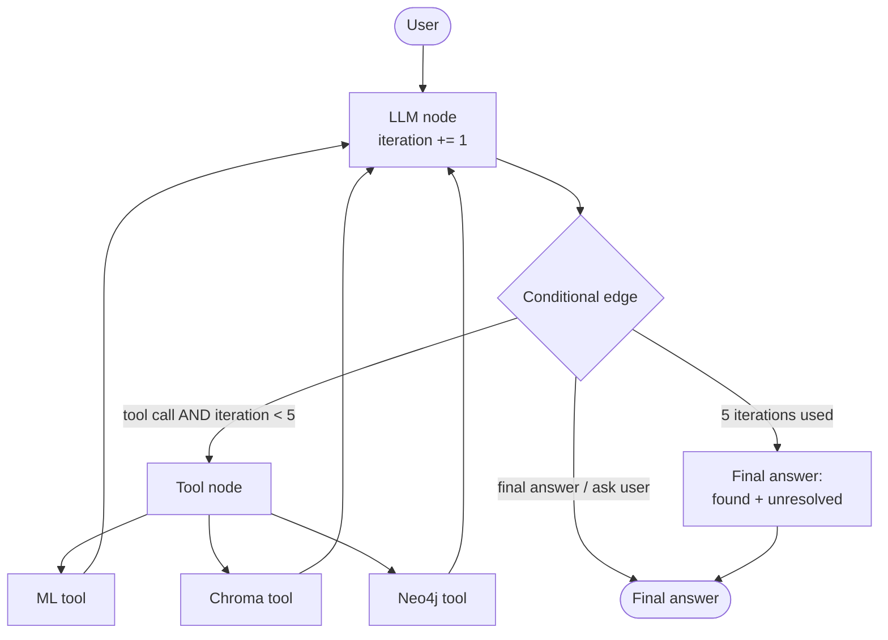

# RAGentML_DS — Student Performance Advisor

An Agentic AI application built with **LangGraph** for a university Data Science course project. One LLM agent understands a student's request, chooses among three tools, processes their results, and writes a grounded final answer.

> **Disclaimer:** This project provides **educational advice only**. It is not medical, psychological, legal or financial advice, and its predictions are estimates from a small dataset.

## 1. Project overview and architecture

Three independent tools (each works on its own):

| Tool | Function | Backend |
|------|----------|---------|
| ML regression | `predict_performance(features: dict)` | scikit-learn model in `models/` |
| Vector search | `search_documents(query: str, k: int = 3)` | ChromaDB (`chroma_db/`) |
| Graph query | `query_graph(query_type: str, params: dict)` | Neo4j |

Details: [docs/architecture.md](docs/architecture.md) · Tool contracts: [docs/contracts.md](docs/contracts.md) · Data sources: [docs/data_sources.md](docs/data_sources.md)



## 2. Prerequisites and installation

- Python 3.10+
- Docker (for Neo4j)
- An LLM API key (provider configurable in `.env`)

```bash
git clone https://github.com/gehad-abdulaziz/RAGentML_DS.git
cd RAGentML_DS
python -m venv .venv
source .venv/bin/activate        # Windows: .venv\Scripts\activate
pip install -r requirements.txt
cp .env.example .env             # Windows: copy .env.example .env
# edit .env: LLM_PROVIDER, LLM_API_KEY, LLM_MODEL, NEO4J_*, CHROMA_PATH
```

Never commit `.env`.

## 3. Running Neo4j and seeding it

```bash
docker compose up -d
python -m src.graphdb.seed_graph
```

Neo4j browser: http://localhost:7474

## 4. Building the vector DB and training the model

```bash
python -m src.vectordb.build_index
python -m src.ml.prepare_data
python -m src.ml.train_model
```

## 5. Running each tool independently

```bash
python -m src.tools.ml_tool       # ML prediction example
python -m src.tools.vector_tool   # semantic search example
python -m src.tools.graph_tool    # graph query example
```

Or from Python:

```python
from src.tools.ml_tool import predict_performance
predict_performance({"Hours_Studied": 20, "Attendance": 90, "Sleep_Hours": 7})
```

### Running the agent CLI

```bash
python -m src.app.cli
```

## 6. Agent behavior

- **5-iteration limit:** the loop never exceeds `MAX_ITERATIONS = 5` (`src/config.py`). It is a maximum, not 5 fixed calls.
- **Each iteration:** the LLM analyzes the request and previous results, then picks one action: call a tool, ask the user for missing info, or give the final answer.
- **Early stop:** the agent stops as soon as it has enough information.
- **Missing info:** the agent asks the user instead of guessing values.
- **What-if scenarios:** e.g. changing study hours calls the ML tool multiple times and compares results.
- **Iterations exhausted:** the final answer states what was found and what is unresolved.
- **Grounding:** answers use only tool results; no invented values or sources.
- **Error handling:** tools return `{"status": "error", "error": "..."}` instead of raising; invalid inputs and tool errors never crash the agent.
- **Logging format:** one entry per iteration with iteration number, optional short reasoning, selected action, tool input and tool output, written to the console and to `logs/`. TODO (Member 6): paste an example log entry here.

## 7. Running tests

```bash
pytest -v
pytest tests/test_ml_tool.py -v | tee logs/ml_tool_tests.log
```

Test scenarios: [tests/scenarios.md](tests/scenarios.md). Saved test logs (tool calls and agent responses) live in `logs/`.

## 8. Team and branch workflow

Summary (full rules in [CONTRIBUTING.md](CONTRIBUTING.md), ownership in [docs/team_split.md](docs/team_split.md)):

- `main` is protected (final only); `develop` is the integration branch.
- Each member works on their own `feature/*` branch created from `develop` and opens a PR into `develop` with one review from another member.
- Never commit `.env` or API keys.

| Branch | Owner | Files owned | Merges into |
|--------|-------|-------------|-------------|
| `feature/ml-tool` | Member 1 | `src/ml/`, `src/tools/ml_tool.py`, `models/`, `data/raw/`, `data/processed/`, `tests/test_ml_tool.py` | `develop` |
| `feature/rag-ingestion` | Member 2 | `data/documents/`, `src/vectordb/build_index.py` | `develop` |
| `feature/rag-retrieval` | Member 3 | `src/tools/vector_tool.py`, `tests/test_vector_tool.py` | `develop` |
| `feature/graph-tool` | Member 4 | `src/graphdb/`, `src/tools/graph_tool.py`, `data/graph_seed/`, `docker-compose.yml`, `tests/test_graph_tool.py` | `develop` |
| `feature/agent-core` | Member 5 | `src/agent/state.py`, `src/agent/nodes.py`, `src/agent/graph.py`, `docs/architecture.md` | `develop` |
| `feature/agent-interface` | Member 6 | `src/tools/__init__.py`, `src/tools/mock_tools.py`, `src/agent/prompts.py`, `src/agent/logger.py`, `src/app/cli.py`, `src/config.py`, `tests/test_agent.py`, `tests/scenarios.md`, `logs/` | `develop` |

## 9. Member sections

Each member fills in **only their own section** (what they built, how to run it, design decisions, known limitations).

### Member 1 — ML tool
TODO

### Member 2 — RAG ingestion

Implemented the document ingestion pipeline for the Student Performance Advisor project.

**Documents:**
- Prepared 9 educational PDF guides covering academic performance, mathematics, programming, time management, exam preparation, memory and learning, note-taking, motivation, and feedback and goal setting.
- Stored the PDF files in `data/documents/`.

**Implementation:**
- Loaded PDF files and extracted their text page by page using `PyPDFLoader`.
- Split the extracted text into chunks using `RecursiveCharacterTextSplitter`.
- Used a chunk size of 500 tokens and an overlap of 80 tokens.
- Generated multilingual embeddings using `paraphrase-multilingual-MiniLM-L12-v2`.
- Stored the chunks, embeddings, and metadata in ChromaDB.
- Added metadata for each chunk, including its source filename, title, category, page number, and chunk ID.
- Used the shared ChromaDB configuration from `src/config.py`.

**How to build the vector database:**

Run the following command from the project root:

```bash
python -m src.vectordb.build_index
```

**Database configuration:**
- Collection name: `study_guides`
- Database path: `chroma_db/` (configurable through `CHROMA_PATH`).

**Testing:**
- Successfully indexed the prepared PDF documents.
- Generated 43 chunks from 41 extracted PDF pages.
- Verified that the chunks were stored in the `study_guides` collection.
- Tested semantic retrieval using both English and Arabic queries.

**Known limitation:**
- Initial retrieval tests showed stronger ranking for English queries than for some Arabic queries. Further retrieval evaluation and optimization may improve Arabic search results.
### Member 3 — RAG retrieval
TODO

### Member 4 — Graph tool

**What I built:** a Neo4j knowledge graph (55 nodes, 136 relationships) of subjects, courses, topics,
prerequisites, study strategies and learning resources, plus the `query_graph` tool.

**Files:** `src/graphdb/schema.cypher`, `src/graphdb/seed_graph.py`, `src/graphdb/check_links.py`,
`src/tools/graph_tool.py`, `data/graph_seed/*.csv`, `docker-compose.yml`, `tests/test_graph_tool.py`.

**How to run:**
```bash
docker compose up -d                       # start Neo4j (wait ~30 s the first time)
python -m src.graphdb.seed_graph --reset   # clear the graph, then create constraints, nodes and relationships
python -m src.tools.graph_tool             # try all query types without the agent
python -m pytest tests/test_graph_tool.py -v | tee logs/graph_tool_tests.log
```

**Design decisions:**
- Fixed set of 6 query types, each with ONE parameterized Cypher statement (no string formatting -> no Cypher injection).
- `MERGE` + uniqueness constraints -> seeding is idempotent. `--reset` clears the graph first (needed after removing rows from the CSVs).
- The seed script validates every CSV reference first, so a typo can't silently drop a relationship.
- Topic and strategy names come from the PDFs, so the agent can use graph names as search queries in the vector DB.
- Case-insensitive matching, because the LLM may write "calculus i".
- Prerequisite queries follow chains (`*1..5`) and return a `distance`.
- Tool never raises: all failures (bad input, Neo4j down) return `{"status": "error", ...}`; unknown entity returns `ok` with `rows: []`.

**Known limitations:** small hand-made graph; course codes are fictional; only Python-based programming resources.

### Member 5 — Agent core (LangGraph)
TODO

### Member 6 — Agent interface (LLM, registry, prompts, logging, CLI)
TODO
