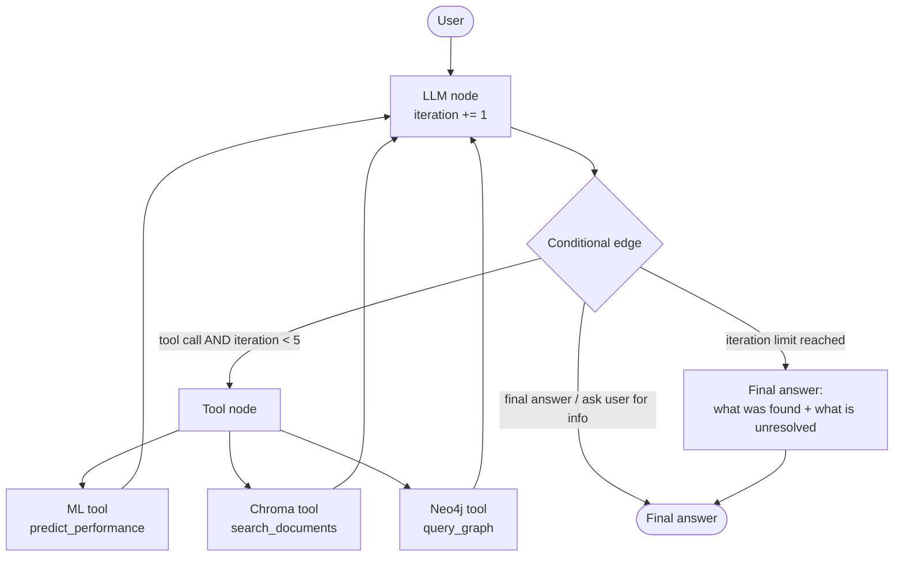

# Architecture

Owner: Member 5 (feature/agent-core). Fill in details as the agent is implemented.

## Overview

"Student Performance Advisor" is one LLM agent built with LangGraph. In each iteration the LLM analyzes the request and the previous tool results, then picks one action: call a tool, ask the user for missing info, or give the final answer. The loop may stop early and never exceeds **5 iterations**.

Three independent tools:

| Tool | Backend | Purpose |
|------|---------|---------|
| `predict_performance` | scikit-learn model (`models/`) | predict academic performance; what-if scenarios |
| `search_documents` | ChromaDB (`chroma_db/`) | semantic search over study guides |
| `query_graph` | Neo4j | courses, subjects, topics, prerequisites, resources |

## Diagram

## State

`AgentState` = `messages`, `tool_results`, `iteration` (see `src/agent/state.py` and `docs/contracts.md`).

## Loop rules

- **5-Iteration Limit:** The agent loop is constrained by `config.MAX_ITERATIONS = 5`.
- **Termination conditions:**
  1. The LLM produces a response without tool calls (answering directly or asking the user for missing information) -> routes to `END`.
  2. The LLM requests tools and `iteration < 5` -> routes to `tool_node` -> returns to `llm_node`.
  3. The LLM requests tools and `iteration >= 5` -> routes to `force_final_node` -> generates plain-text synthesis summarizing what was found and what remains unresolved -> routes to `END`.
- **Interactive Multi-Turn Resumption:** When asking the user for missing parameters (e.g. key study habits), the agent finishes its turn. When the student replies, the CLI passes the accumulated conversation history so the agent resumes with full context.

## Error handling

- Tools never raise unhandled exceptions; they return `{"status": "error", "error": "..."}`.
- `tool_node` additionally wraps any tool execution in a try/except safety net.
- When an error occurs, the structured JSON error is returned as a `ToolMessage` to the LLM, enabling it to explain the error or ask the student for corrected values.

## Logging

One structured entry per iteration (see `src/agent/logger.py`): iteration, optional reasoning, action, tool input, tool output.

## Module map

| Module | Responsibility |
|--------|----------------|
| `src/agent/state.py` | `AgentState` |
| `src/agent/nodes.py` | `llm_node`, `tool_node` |
| `src/agent/graph.py` | graph, conditional edges, iteration limit |
| `src/agent/prompts.py` | system prompt, tool descriptions |
| `src/agent/logger.py` | logging |
| `src/tools/__init__.py` | tool registry (LangChain tools) |
| `src/app/cli.py` | CLI |