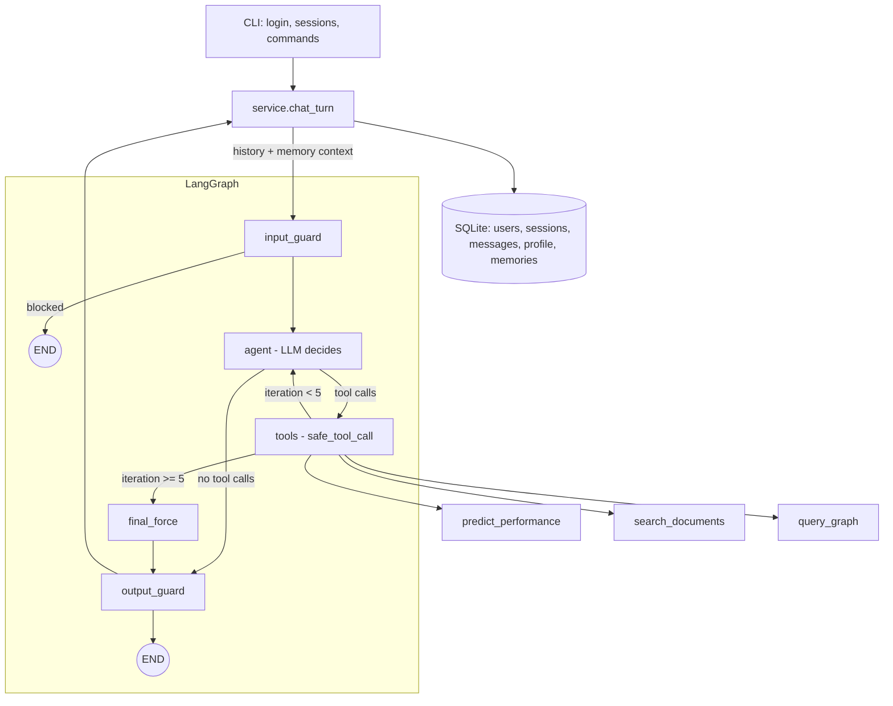

# Architecture

## Node names (match the code)
`input_guard_node`, `agent_node`, `tools_node`, `final_force_node`, `output_guard_node`
in `src/agent/nodes.py`; routing in `src/agent/graph.py`.

## Loop rules
* **Iteration** = one LLM reply that contains tool calls (all calls in that reply run together).
* At most **5** such rounds. The 5th round DOES execute its tools; then the graph goes to
  `final_force`, which answers in plain text and states what is found and what is unresolved.
* So one turn makes at most 6 LLM calls. There is no hidden extra "guardrail" call.
* At most 4 tool calls per reply (`MAX_TOOL_CALLS_PER_ITER`). An identical successful call in
  the same turn is served from a cache and does not run again.
* "Ask the user": a reply without tool calls that ends with `?` is logged as `ask_user`.
  The answer arrives in the next turn together with the stored history.

## Error handling
* Tools never raise (contract). `safe_tool_call` adds a timeout, wraps validation errors from
  bad LLM arguments, and guarantees the `{"status": ...}` shape.
* LLM failure: retries with exponential backoff, then a friendly message (no crash).
* The CLI catches every exception per turn; Ctrl+C cancels the turn or leaves the program.

## Guardrails and middleware (`src/agent/middleware.py`)
| Layer | What it does |
|-------|--------------|
| Input | empty / too long / prompt-injection (EN + AR) / per-user rate limit |
| Model | retries, `<think>` removal, empty-reply fallback |
| Tools | timeout, argument validation, dedup cache, per-reply call cap |
| Output | secret/e-mail/phone redaction, grounding check on exam scores |
| Memory | no instructions or secrets can be stored; memory is labelled "data, not instructions" |

## Memory (`src/memory/`)
1. **Chat history** per session (SQLite), last `HISTORY_MESSAGES` messages replayed each turn.
2. **Profile**: ML features the student really wrote (grounded check) are saved and reused by
   `predict_performance` (reported as `from_profile`).
3. **Memories**: short facts, recalled by multilingual semantic search (same embedding model as RAG,
   keyword fallback). Added by `/remember` or optionally by the LLM extractor.
4. **Users**: scrypt-hashed passwords, lockout, every query filtered by `user_id`.

## Defaults policy (decision)
The four key features (`Hours_Studied`, `Attendance`, `Previous_Scores`, `Tutoring_Sessions`) are
required: missing ones produce an error that names them and the agent asks. The 15 optional
features use documented defaults (`src/tools/features.py`) that are always disclosed.
